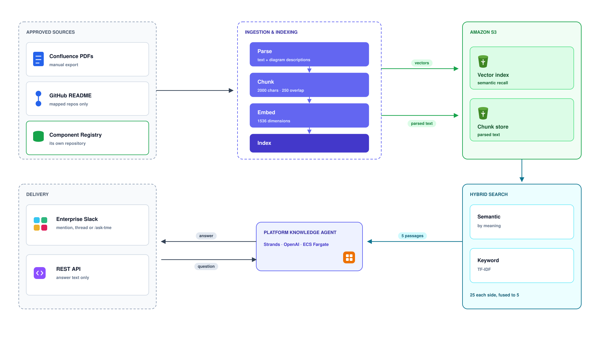

# Core Platform

Core Platform is the shared runtime for a source-grounded knowledge application.
It provides the application, Bedrock retrieval, model integration, conversation
delivery and infrastructure needed to run a knowledge assistant.

This repository contains reusable platform code and the self-contained KIP reference
deployment. External deployment and tenant repositories are optional inputs for teams
that adopt the platform in their own AWS accounts.

## Capabilities



See [architecture notes](docs/architecture.md) for implementation details and planned work.

- FastAPI knowledge query API
- Optional Slack delivery
- Managed Bedrock Knowledge Bases retrieval from approved Confluence spaces
- Amazon Nova Lite generation through the Strands Bedrock provider
- Verified user identity on every knowledge query
- Grounded answers with citations and safe refusal behavior
- Optional streaming, conversation persistence, summaries and text visuals
- Opt-in live knowledge-source inspection and approval-gated, resumable sync tasks
- Configurable system-prompt caching with cache token metrics
- Terraform infrastructure templates and deployment scripts

The Core Platform deployment creates its own VPC, public subnets, routing and
internet gateway in `us-east-1`. The ALB and ECS service use those public subnets.
Network IDs are derived from Terraform-managed resources; only the VPC and public
subnet CIDR blocks are supplied through variable files.

## Repository layout

```text
app/       Application runtime and integrations
infra/     Terraform infrastructure
scripts/   Ingestion and operational commands
tests/     Offline tests and neutral fixtures
docs/      Core architecture documentation
```

`infra/bedrock.tf` manages the Bedrock knowledge base and its Confluence connector
in `us-east-1`, alongside the other infrastructure in the same Terraform root
and state. The KIP reference deployment inputs are kept in `infra/terraform.tfvars`.
The existing execution role and credentials secret are referenced
by ARN. The application uses this KB directly; it needs no OpenAI key, registry
or separate vector index. Terraform commands are
in this repository. Existing visual assets are preserved;
the architecture notes distinguish the old custom-index diagram from the new runtime.

## Local development

The project targets Python 3.14.

If you already use the `kip` conda environment, activate it with `conda activate kip`
and use that environment instead of creating another virtual environment.

```bash
python -m venv .venv
source .venv/bin/activate
pip install -r requirements.txt
pip install -e ".[dev]"
cp .env.example .env
```

Run the API:

```bash
export AWS_PROFILE=your-profile
fastapi dev app/main.py
```

Fill in the KB ID in .env first. The default model is amazon.nova-lite-v1:0
in us-east-1. The AWS identity needs permission to retrieve the KB, read its
status and invoke the selected model, including streaming. Connector sync also
requires bedrock:StartIngestionJob. Bedrock owns embeddings; no separate embedding
model access is needed by this runtime.

Run the checks:

```bash
pytest
ruff check .
mypy
python -m compileall -q app scripts
```

## Configuration

Runtime settings use the `KNOWLEDGE_INTELLIGENCE_` prefix. Configure the knowledge
base, model and delivery channels through environment variables.
Secrets must be supplied through the local environment or deployment secret manager
and must never be committed.

When the API, Slack or administrative endpoint is enabled for an AWS deployment,
create the application secret named by `application_secret_name`. Its JSON keys are
`QUERY_TOKENS`, `SLACK_BOT_TOKEN`, `SLACK_SIGNING_SECRET` and `ADMIN_TOKEN`; only
keys for enabled interfaces are required.

## Knowledge-source tasks

The optional task API inspects the configured knowledge source, proposes a sync,
requires explicit approval from an approver other than the requester, and starts or
resumes tracking the AWS job.
Use the **Knowledge tasks** group in Swagger at `/docs`.

Enable `KNOWLEDGE_INTELLIGENCE_TASKS_ENABLED` only after configuring S3 task storage,
the KB data source, `KNOWLEDGE_INTELLIGENCE_TASK_ALLOWED_IDENTITIES` (requesters) and
`KNOWLEDGE_INTELLIGENCE_TASK_APPROVER_IDENTITIES` (approvers). Both are JSON lists of
identities already in `QUERY_TOKENS`, and each requester needs an approver other than
themselves; ordinary knowledge access
does not grant task permissions. State is stored under `TASK_PREFIX`, default `tasks`.
Terraform exposes the corresponding variables in the existing infra root and state.

Read [KIP knowledge-source tasks](docs/confluence/knowledge-tasks.md) for the complete
Swagger sequence, required permissions, retry behavior and operational boundaries.
The existing `/knowledge/query`, Slack and `/admin/reindex` contracts remain unchanged.

The knowledge agent uses `strands_harness.create_harness` with only explicitly configured
tools and plugins. Built-in shell, file, web, local memory, local sessions and
background execution are disabled. Runtime dependencies pin Strands SDK 1.57.2 and
Strands Harness 0.1.2.

Set `KNOWLEDGE_INTELLIGENCE_BEDROCK_PROMPT_CACHING_ENABLED=true` to add a cache
checkpoint after stable system instructions. It defaults to false. The selected
model must support system-prompt caching; changing models does not establish that
support. Dynamic questions and retrieved passages remain outside the checkpoint.
Nova Lite does not support tool-definition checkpoints, so none are added.
Cache hits depend on prefix length and reuse; use the cache read/write token fields
in invocation metrics to assess the effect. This is not an answer cache and does
not skip knowledge retrieval.

## API and Slack access

Set KNOWLEDGE_INTELLIGENCE_QUERY_TOKENS to a JSON object mapping application
account emails to unique, randomly generated bearer tokens. For example:

```dotenv
KNOWLEDGE_INTELLIGENCE_QUERY_TOKENS={"reader@example.com":"replace-with-a-random-secret"}
```

Send that user's token in the Authorization: Bearer header on /knowledge/query.
The server chooses the email from its secret mapping; request bodies cannot
override it. With no mapping, the query API is unavailable. This initial token
mapping is not SSO; keep it server-side and rotate tokens as needed.

Slack requires signed events and users:read plus users:read.email permissions,
alongside the existing chat and direct-message permissions. Reinstall the Slack
app after changing scopes. Slack email is used locally to identify the conversation owner.
Knowledge answers are restricted to direct messages; channel requests receive a
redirect. Protected visuals are delivered as text, not public image URLs.

Start a connector sync or run a trusted local query:

```bash
python -m scripts.ingest
python -m scripts.validate_search "What does this platform do?"
```

The local query uses your AWS credentials and is an administrative testing tool.
Ingestion returns
a job ID immediately; check completion in Bedrock. The protected /admin/reindex
endpoint similarly returns HTTP 202. Empty retrieval results produce a safe refusal before the model is called.

Confluence credentials stay in the connector's Secrets Manager secret and are
never read by the application. S3 is needed only for optional Slack feedback and
conversation persistence. The old custom ingestion, registry and S3 Vectors code and
infrastructure have been removed.

Bedrock receives no user identity in retrieval requests. Configure Confluence with
aclEnabled=false and crawlIdentities=false. All authorized users of this deployment
share access to its approved source content. User authentication and conversation
separation remain local to the application.

To test in Swagger, open http://127.0.0.1:8000/docs, click Authorize, enter the token
without the Bearer prefix, then execute POST /knowledge/query. Restart the API after
changing .env.

The optional evaluation command consumes explicitly supplied datasets:

```bash
python -m scripts.evaluate --datasets /path/to/approved/datasets
```

## Extension boundary

The KIP reference deployment keeps its infrastructure inputs in this repository.
An adopting team may provide separate deployment configuration and tenant content
repositories when it deploys Core Platform in another AWS account. Core Platform
remains responsible for runtime behavior, interfaces and shared infrastructure
templates.
